

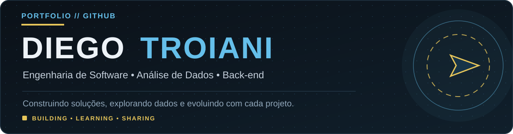

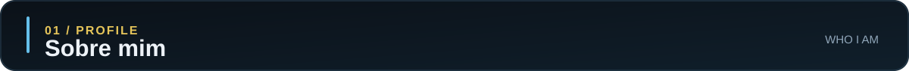

Sou estudante de **Engenharia de Software na UNICID**, com formação técnica em Dev Full Stack e experiência profissional em **tecnologia, operações e gestão de indicadores**, especialmente no segmento de Digital Signage (DOOH).

Tenho interesse em **Análise de Dados, desenvolvimento back-end e sistemas embarcados**. Gosto de desenvolver projetos que aproximam programação, dados e soluções para problemas reais.

> **Objetivo:** evoluir continuamente como profissional de tecnologia, construindo soluções com clareza, responsabilidade e ética.

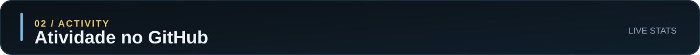

Dados calculados por serviço externo a partir dos repositórios públicos; podem ficar temporariamente indisponíveis.

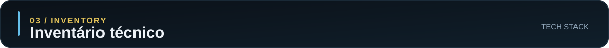

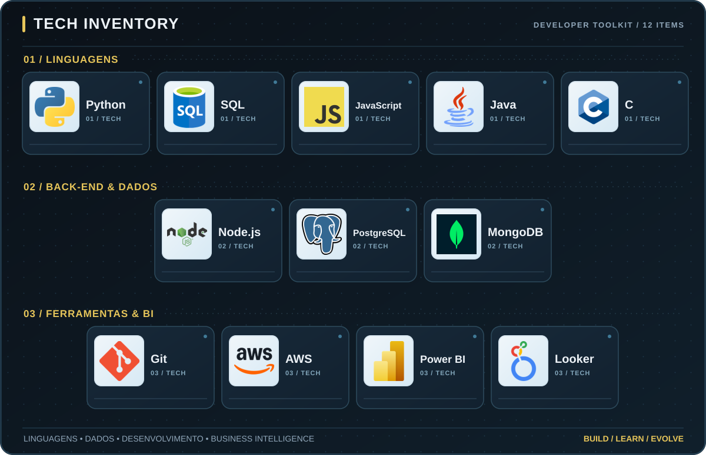

Os ícones são pictogramas estilizados e as categorias representam áreas de contato e estudo, não níveis de proficiência. O foco atual é Python, SQL e aplicações orientadas a dados.

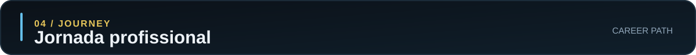

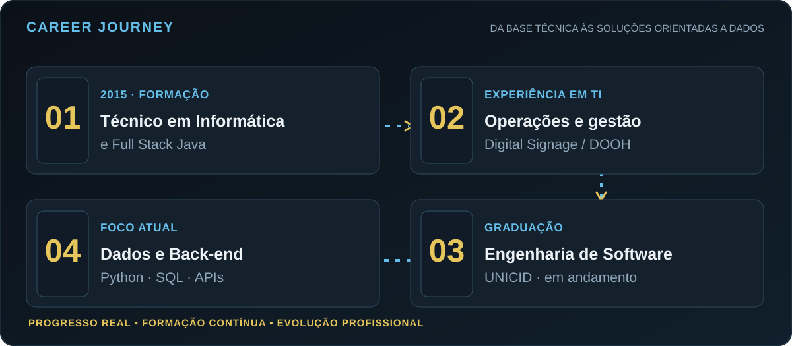

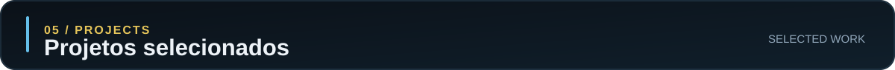

<table>
  <tr>
    <td width="50%" valign="top">
      <h3>🔹 VarX View</h3>
      
<strong>Audiência e indicadores para varejo</strong>

      
API em Python/FastAPI e PostgreSQL, com processamento local e análise de fluxo e audiência.

      
<code>Python</code> <code>FastAPI</code> <code>PostgreSQL</code> <code>APIs</code>

    </td>
    <td width="50%" valign="top">
      <h3>🔹 Garage Hair</h3>
      
<strong>Projeto acadêmico web e de dados</strong>

      
Site responsivo e acessível, com desenvolvimento front-end e modelagem de um sistema de gestão.

      
<code>HTML</code> <code>CSS</code> <code>JavaScript</code>

      <a href="https://garagehairunicid.vercel.app/">Ver site</a>
    </td>
  </tr>
  <tr>
    <td valign="top">
      <h3>🔹 SortLab</h3>
      
<strong>Laboratório de algoritmos em C</strong>

      
Estudo comparativo de Bubble, Insertion, Selection, Merge e Quick Sort, com medições e arquivos de registro.

      
<code>C</code> <code>Algoritmos</code> <code>Arquivos</code>

    </td>
    <td valign="top">
      <h3>🔹 Green LED</h3>
      
<strong>Eficiência energética em LED</strong>

      
Estudo aplicado sobre brilho, consumo energético e oportunidades de otimização de painéis.

      
<code>Indicadores</code> <code>Análise</code> <code>Eficiência Energética</code>

    </td>
  </tr>
</table>

**[Explorar meus repositórios no GitHub](https://github.com/ditroiani?tab=repositories)**

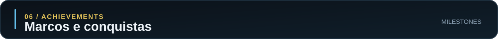

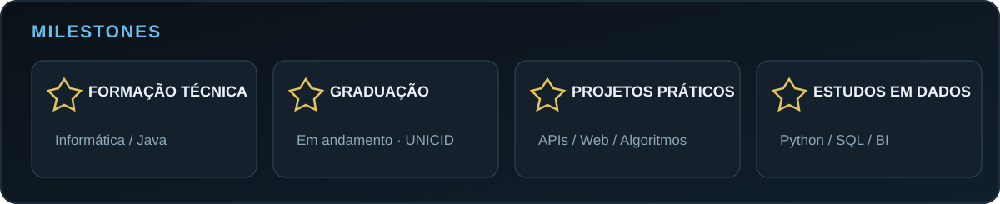

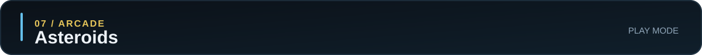

[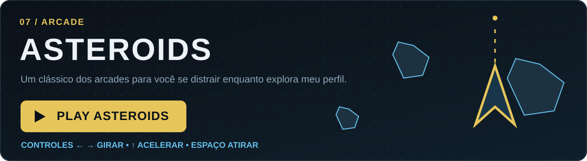](https://ditroiani.github.io/ditroiani/)

**[▶ JOGAR ASTEROIDS](https://ditroiani.github.io/ditroiani/)**

Use **← →** para girar, **↑** para acelerar, **Espaço** para atirar e **P** para pausar.  
O jogo abre em uma página própria, pois o README não executa JavaScript interativo.

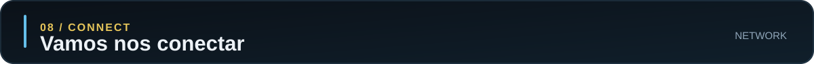

[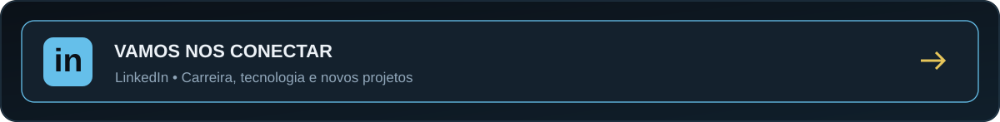](https://www.linkedin.com/in/dtroiani/)

**Tecnologia, aprendizado e colaboração. Vamos trocar ideias!**

---

Projetos, aprendizado e evolução contínua • Desenvolvido com dedicação

